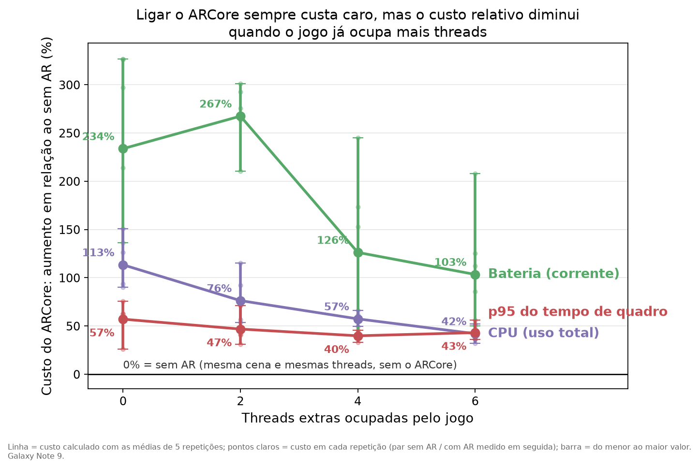
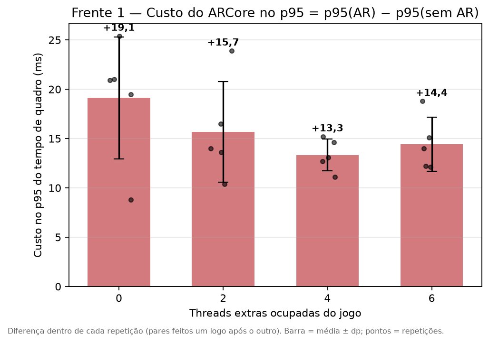
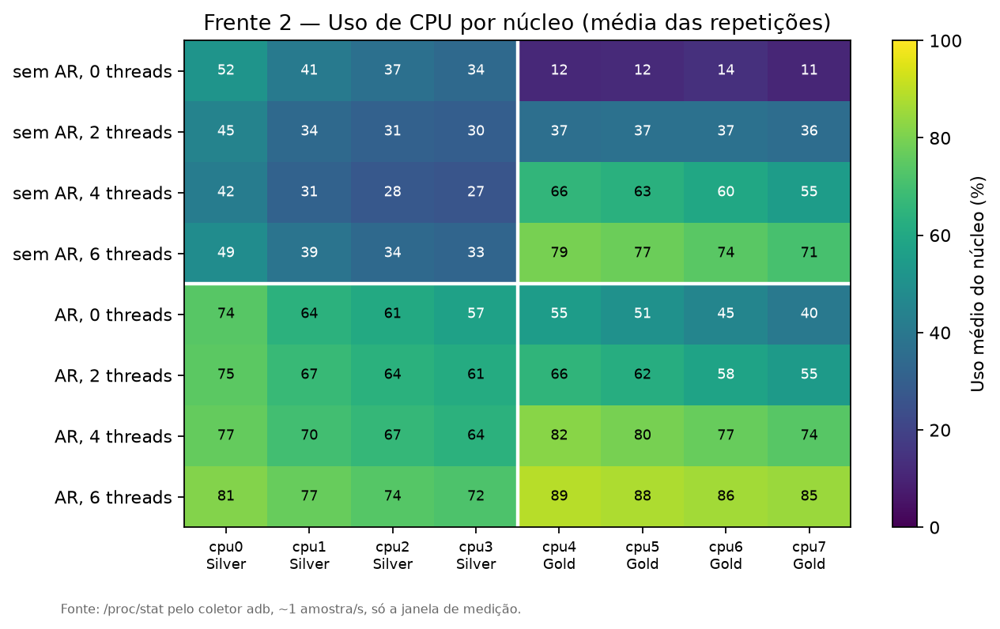
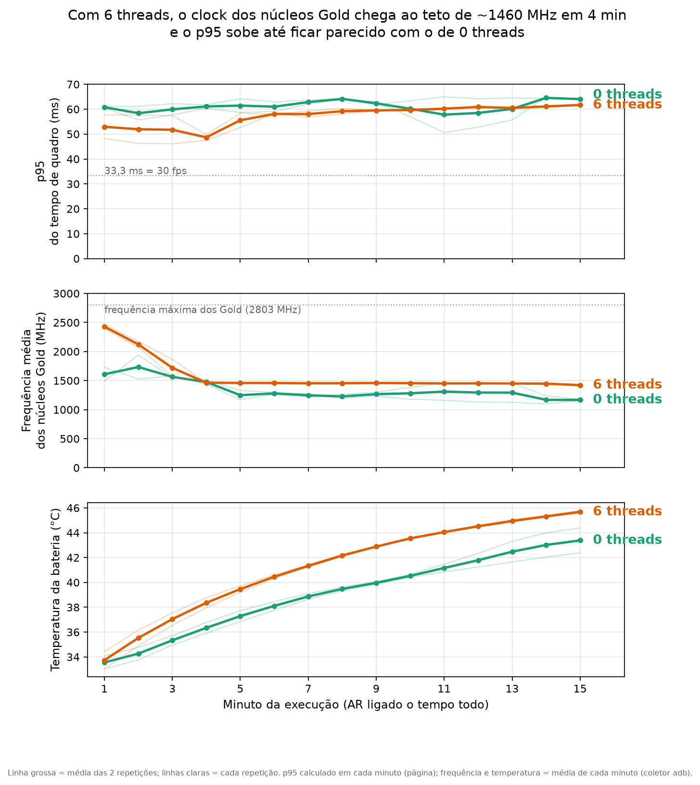
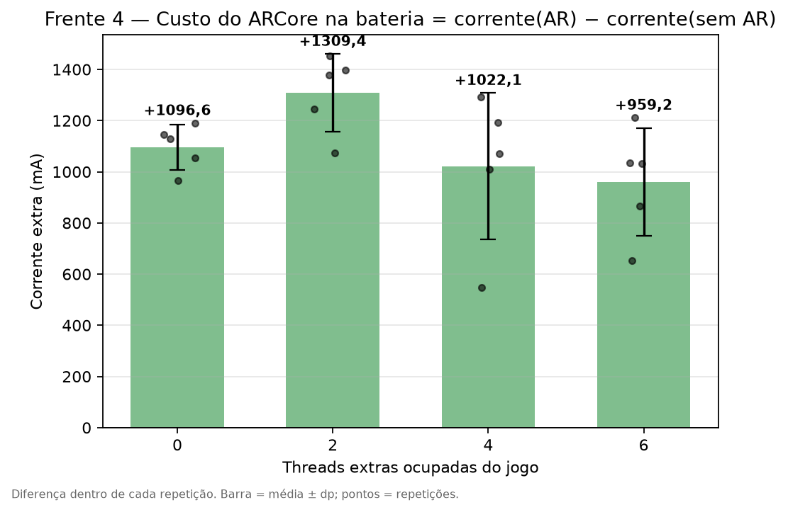

# Quanto custa o rastreamento de posição do ARCore num celular que roda um jogo 3D

**Projeto 2 — Custo · Sistemas Operacionais (CC) 2026.2 · Prof. Lucas Figueiredo · Turma 4D**
Grupo *a cat e os cuiudo pt2*: Caue Santana, Mateus Sarmento, Catarina Silva e Meirelles, Thomas Bulhõez

Repositório: https://github.com/CatLLS/VR-camera-tracking-cost-analysis — dados brutos em [`dados/`](dados/),
scripts em [`tools/`](tools/) e [`analise/`](analise/), página de medição em [`docs/`](docs/).

---

## 1. Pergunta

**Quanto custa o rastreamento de posição do ARCore rodando junto com uma cena 3D no mesmo celular,
quando mudo o número de threads ocupadas do jogo (0, 2, 4, 6), medido em p95 do tempo de quadro (ms)?**

Motivação: um headset do tipo Cardboard usa o próprio celular para rodar o jogo e não tem sensores para
rastrear a posição da pessoa na sala. O ARCore (Google) rastreia a posição usando a câmera e os sensores
de movimento, mas roda no mesmo processador que o jogo. Medimos o custo dele em quatro frentes: tempo de
quadro, uso de CPU por núcleo, degradação em 15 minutos e bateria.

**Mecanismos do sistema operacional que geram o custo:** o escalonador do Linux/Android distribui as
threads do ARCore, da renderização e do jogo entre 8 núcleos de dois tipos (big.LITTLE); o governador de
frequência (cpufreq) sobe e desce o clock de cada grupo de núcleos conforme a carga; e o controle térmico
corta a frequência máxima quando o chip esquenta (*thermal throttling*).

## 2. Método

**Dispositivo:** Samsung Galaxy Note 9 (SM-N9600), Android 10, Snapdragon 845 — 4 núcleos **Silver**
(0–3, econômicos, até ~1,77 GHz) e 4 núcleos **Gold** (4–7, rápidos, até 2,8 GHz), GPU Adreno 630.
Chrome 157 para Android.

**Carga:** uma página web feita pelo grupo ([`docs/`](docs/), versão `2.1.1-ar-threads`) que desenha uma
cena 3D sintética em Three.js (3000 objetos presos à câmera, resolução nativa) e abre N threads extras do
"jogo" (Web Workers, que no Chrome são threads reais do sistema). Cada thread faz contas por 5 ms e pausa
5 ms (50% ocupada), e registra quanto trabalho completou por segundo. No modo **AR**, a página abre uma
sessão WebXR `immersive-ar`, e o ARCore usa a câmera traseira e os sensores para rastrear a posição. No
modo **sem AR**, a mesma cena roda sem câmera e sem ARCore, limitada a 30 fps (a taxa que o AR consegue
no aparelho), para que os tempos de quadro sejam comparáveis.

**Condições:** 2 modos (sem AR, com AR) × 4 valores de threads (0, 2, 4, 6) = 8 condições.
**Custo do ARCore** = valor com AR − valor sem AR, com o mesmo número de threads, calculado dentro de
cada repetição.

**Repetições e ordem:** 5 repetições de 120 s por condição (40 execuções), em 5 rodadas. A ordem das
condições muda a cada rodada (quadrado latino de Williams), e o par sem AR / com AR do mesmo número de
threads é medido um logo após o outro. Os 5 s iniciais de cada execução são descartados (aquecimento).

**Frente 3:** 4 execuções de 15 min, só com AR, nos extremos da variável (0 e 6 threads), 2 repetições
cada, na ordem 0, 6, 6, 0.

**Protocolo de cada execução** (passo a passo em [`TestGuide.md`](TestGuide.md)): página recarregada
antes de cada execução; celular em modo avião com Wi-Fi (adb por Wi-Fi, sem cabo, para não carregar);
brilho fixo; uma aba; a pessoa anda ida e volta entre duas marcas a 3 m, um passo por batida de um
metrônomo a 60 bpm, segurando o celular com as duas mãos, também no modo sem AR; antes de cada execução,
espera a bateria voltar a no máximo 1 °C acima da temperatura de repouso do dia, com bateria ≥ 50%.

**Como cada métrica foi medida:**

| Métrica | Fonte | Detalhe |
|---|---|---|
| p95 do tempo de quadro (ms) | a própria página | intervalo entre quadros consecutivos (`requestAnimationFrame` ou `XRSession.requestAnimationFrame`); p95 pelo posto mais próximo |
| Uso de CPU por núcleo (%) | [`tools/coletor_adb.py`](tools/coletor_adb.py) no PC, via adb | `/proc/stat`, diferença entre amostras, ~1 amostra/s |
| Frequência dos núcleos (MHz) | coletor adb | `/sys/devices/system/cpu/cpu*/cpufreq/scaling_cur_freq` |
| Temperatura (°C) | coletor adb | `/sys/class/thermal/thermal_zone*/temp` (sensores dos núcleos Gold e Silver) e `dumpsys battery` (bateria) |
| Corrente de descarga (mA) | coletor adb | `/sys/class/power_supply/battery/current_now` (no Samsung, em mA) |

A análise é feita por [`analise/gerar_graficos.py`](analise/gerar_graficos.py), que lê os arquivos
brutos e gera as tabelas e os gráficos. As escolhas da análise (qual execução vale quando houve repetição,
como os dados do coletor foram recortados, rótulos corrigidos) estão em [`analise/README.md`](analise/README.md).

**Desvios do protocolo, registrados:**
- Os horários gravados pela página ficaram atrasados em 24/11, porque o relógio que ela usa
  (`performance.timeOrigin`) para quando o celular dorme com a tela apagada entre execuções. Os tempos
  dentro de cada execução não são afetados; os dados do coletor desse dia foram recortados por uma janela
  fixa a partir do início do coletor (15 s a 120 s).
- Dois rótulos digitados errado foram corrigidos na análise ([`analise/correcoes.csv`](analise/correcoes.csv)),
  sem alterar os arquivos originais.
- Em `ar_t0_r1`, o coletor começou ~23 s atrasado (CPU e bateria cobrem 80% da janela).
- A execução de 15 min `ar_t6_r1` começou com a bateria em 70% (o guia pedia ≥ 80%).
- As execuções de 15 min (25/11) foram feitas com o celular servindo de ponto de acesso Wi-Fi para o PC
  (rede própria do celular), o que acrescenta carga de rádio igual nas 4 execuções.
- O arquivo de temperatura de repouso foi sobrescrito por engano durante o dia em 21/11 e em 25/11; o
  valor medido às 08:59 de 25/11 (35,4 °C) está no histórico do git.
- Execuções feitas com versões anteriores da página (com um erro que desenhava a cena duas vezes) foram
  descartadas e estão em [`dados/descartado/`](dados/descartado/), com o motivo.

## 3. Hipóteses (antes de medir)

**Do grupo (formulário do projeto):** esperamos que o custo do ARCore no p95 do tempo de quadro suba quando o número de
threads ocupadas do jogo sobe, com um salto quando as threads do jogo, da renderização e do ARCore passam
a ser mais que os núcleos livres (a partir de 4 threads extras, quando os 4 núcleos rápidos ficam
ocupados), porque o ARCore passa a esperar na fila do escalonador ou a rodar nos núcleos econômicos.

**Frente 1 — p95 do tempo de quadro (Mateus Sarmento):** espero que o p95 do tempo de quadro com ARCore
suba conforme o número de threads extras ocupadas do jogo aumenta (de 0 para 2, 4 e 6), com um salto mais
acentuado a partir do limite de 4 threads extras.

**Frente 2 — Uso de CPU por núcleo (Caue Santana):** [PREENCHER: hipótese do Caue na Ficha 3]

**Frente 3 — Degradação em 15 minutos (Catarina Silva e Meirelles):** espero que o p95 do tempo de quadro
suba entre o 1º e o 15º minuto com o AR ligado, junto com a subida da temperatura e a queda da frequência
dos núcleos Gold, e que o aumento seja maior em ar_t6 do que em ar_t0, parando quando a temperatura
chegar a um equilíbrio. Por quê: com o ARCore, a cena 3D e as threads rodando juntos, a CPU e a GPU
trabalham perto do limite e o celular esquenta; o controle térmico do Android reduz a frequência máxima
permitida pelo cpufreq (*thermal throttling*), e cada quadro passa a demorar mais. O que contrariaria: o
p95 do 15º minuto igual ao do 1º mesmo com a temperatura subindo; a frequência dos Gold não cair.

**Frente 4 — Bateria (Thomas Bulhõez):** espero que a corrente média de descarga aumente conforme o número
de threads ocupadas pelo jogo sobe de 0 para 2 e 4, mas estabilize em um patamar máximo a partir de 4
threads extras, quando a capacidade total dos núcleos da CPU se esgota. Por quê: com mais threads do jogo
disputando os mesmos núcleos com as threads do rastreamento do ARCore e da renderização, o escalonador
precisa manter os núcleos ativos por mais tempo e fazer mais trocas de contexto; isso impede que os
núcleos entrem em estados de economia de energia (idle), elevando o consumo, mas só até a saturação dos
núcleos, a partir de 4 threads. O que contrariaria: a corrente diminuir, ficar constante desde 0 threads
ou continuar subindo depois que todos os núcleos atingirem 100% de ocupação.

## 4. Resultados

### Tabela de medição

Valores: **sem AR → com AR** (custo do AR = com − sem, calculado dentro de cada repetição). Média de 5
repetições de 120 s; ± = desvio padrão.

| Threads extras do jogo | Uso de CPU (%) — Silver 0-3 / Gold 4-7 | CPU total (%) | p95 do tempo de quadro (ms) | Corrente média de descarga (mA) |
|---|---|---|---|---|
| 0 | Silver 41 → 64 / Gold 12 → 48 | 26,2 → 55,9 (+29,7 ± 4,2) | 33,5 → 52,6 ± 6,2 (**+19,1 ± 6,2**) | 469 → 1566 (**+1097 ± 89**) |
| 2 | Silver 35 → 67 / Gold 37 → 60 | 36,0 → 63,5 (+27,5 ± 7,0) | 33,5 → 49,2 ± 5,1 (**+15,7 ± 5,1**) | 490 → 1799 (**+1309 ± 152**) |
| 4 | Silver 32 → 69 / Gold 61 → 78 | 46,9 → 73,8 (+26,9 ± 2,5) | 33,5 → 46,8 ± 1,6 (**+13,3 ± 1,6**) | 810 → 1832 (**+1022 ± 287**) |
| 6 | Silver 39 → 76 / Gold 76 → 87 | 57,5 → 81,6 (+24,1 ± 3,4) | 33,5 → 47,9 ± 2,7 (**+14,4 ± 2,7**) | 928 → 1887 (**+959 ± 211**) |

O fps médio caiu pouco com o AR (30,0 → 28,1 a 28,8 fps). O rastreamento completo do ARCore ficou em
≥ 98,5% dos quadros em todas as execuções com AR. Valores de cada execução:
[`analise/tabelas/execucoes.csv`](analise/tabelas/execucoes.csv).

**Frente 3 — 15 minutos com AR** (1º minuto → 15º minuto, cada repetição):

| Condição | p95 (ms) | Aumento do p95 | Temp. bateria (°C) | Temp. núcleos Gold (°C) | Frequência Gold (MHz) |
|---|---|---|---|---|---|
| ar_t0 rep 1 | 61,1 → 64,1 | +3,0 ms | 34,1 → 44,4 | 63,6 → 74,3 | 1730 → 1178 |
| ar_t0 rep 2 | 60,5 → 64,0 | +3,5 ms | 33,0 → 42,4 | 59,9 → 70,3 | 1489 → 1157 |
| ar_t6 rep 1 | 48,2 → 61,5 | +13,3 ms | 33,0 → 45,8 | 83,0 → 83,4 | 2461 → 1414 |
| ar_t6 rep 2 | 57,7 → 61,9 | +4,2 ms | 34,4 → 45,6 | 83,0 → 83,8 | 2398 → 1431 |

Minuto a minuto: [`analise/tabelas/frente3_por_minuto.csv`](analise/tabelas/frente3_por_minuto.csv).

### Gráfico do grupo

Custo em % = (com AR − sem AR) / sem AR × 100. Linha = médias das 5 repetições; pontos = cada repetição;
barra = do menor ao maior valor.

### Gráficos de cada frente

| | |
|---|---|
|  |  |
| **Frente 1** — custo do ARCore no p95 (ms) | **Frente 2** — uso de cada núcleo (%) |
|  |  |
| **Frente 3** — p95, clock e temperatura em 15 min | **Frente 4** — corrente extra do ARCore (mA) |

Todos os gráficos: [`analise/graficos/`](analise/graficos/).

## 5. Discussão

**Hipótese do grupo — contrariada.** O custo do ARCore no p95 **não subiu** com as threads: foi de
+19,1 ms (0 threads) para +15,7, +13,3 e +14,4 ms (2, 4 e 6 threads), e não houve salto em 4 threads.
Como o modo sem AR ficou em 33,5 ms em todas as condições (limitado a 30 fps), a queda vem do p95 com AR,
que diminuiu de 52,6 para 46,8–47,9 ms. Os dados das outras frentes mostram o que o sistema fez:

- **O trabalho extra do ARCore foi sendo empurrado para os núcleos Silver.** Sem AR, as threads do jogo
  ocupam os Gold (de 12% com 0 threads a 76% com 6). Com 0 threads, o AR aumentou o uso dos dois grupos
  (Silver +23, Gold +36 pontos percentuais); à medida que as threads do jogo tomam os Gold, o acréscimo
  do AR aparece cada vez mais nos Silver e menos nos Gold (com 6 threads: Silver +37, Gold +12).
- **Com mais trabalho, o governador subiu o clock dos Gold.** Com AR, a frequência média dos Gold foi de
  2035 MHz (0 threads) para ~2400 MHz (2 e 4 threads) ([`F2_5`](analise/graficos/F2_5_frequencia_cpu.png)).
  Nossa interpretação: a parte do quadro que roda nos Gold (renderização e parte do ARCore) fica mais
  rápida quando as threads do jogo mantêm o clock alto, e por isso o p95 com AR caiu com as threads.
- **A disputa aparece só com 6 threads.** Com 6 threads e AR, os Gold ficam 87% ocupados, a frequência
  média cai para 2154 MHz, o p95 volta a subir um pouco (46,8 → 47,9 ms) e cada thread do jogo faz 18%
  menos trabalho que sem AR (4811 contra 5866 unidades/s). Com 2 threads, ao contrário, as threads faziam
  mais trabalho com AR (7225 contra 4753), por causa do clock mais alto
  ([`F2_4`](analise/graficos/F2_4_vazao_threads_do_jogo.png)).

**Frente 1 (Mateus):** *os dados contrariam a hipótese*. Com AR, o p95 foi de 52,6 ms (+19,1 ms em
relação ao sem AR) com 0 threads para 49,2 ms (+15,7), 46,8 ms (+13,3) e 47,9 ms (+14,4) com 2, 4 e 6
threads; sem AR, ficou em 33,5 ms (30 fps) em todas as condições. De 0 para 4 threads, o p95 com AR caiu
5,8 ms (~11%), mesmo com a CPU subindo de 55,9% para 73,8%. Com pouca carga (0 threads), o governador
de frequência (DVFS) mantém os núcleos em clocks mais baixos, o que causa picos de latência; com 4
threads, a carga constante faz o sistema manter frequências mais altas e estáveis. Só com 6 threads
(81,6% de CPU) o p95 volta a subir (+1,1 ms), sinal de início de disputa por CPU ou de *throttling*.

**Frente 2 (Caue):** *os dados sustentam a hipótese*. CPU total com AR (média dos 8 núcleos): sobe de
55,9% ± 3,2 (0 threads) para 63,5% ± 4,6 (2), 73,8% ± 1,8 (4) e 81,6% ± 2,4 (6). No Galaxy Note 9, o
escalonador do Android concentra tarefas leves nos 4 núcleos Silver e direciona as cargas pesadas, como o
ARCore e até 4 threads extras do jogo, para os 4 núcleos Gold, que chegam a 78% de uso a 2,4 GHz. Ao
rodar 6 threads junto com o AR, os Gold saturam (87%) e o sistema precisa transbordar o excesso para os
Silver, mais lentos (76%). Isso reduz o impacto marginal do AR na CPU (de +29,7 para +24,1 pontos
percentuais) e derruba em 33% o trabalho feito por thread do jogo (de 7225 unidades/s com 2 threads para
4811 com 6), por causa das filas de espera.

**Frente 3 (Catarina):** *os dados sustentam a hipótese*, com as ressalvas abaixo. Nas 4 execuções o p95
subiu entre o 1º e o 15º minuto (+3,0 e +3,5 ms com 0 threads; +13,3 e +4,2 ms com 6), a bateria
esquentou de 9 a 13 °C e a frequência dos Gold caiu. O que o sistema fez fica claro com 6 threads: os
sensores dos Gold já estão em ~83 °C desde o 1º minuto, e entre o 4º e o 5º minuto a frequência dos
Gold para **em 1459 MHz** nas duas repetições, embora 6 threads ocupadas pedissem mais. É um teto
imposto pelo controle térmico, e não falta de trabalho. Quando o teto entra (minutos 4–6), o p95 de
ar_t6 sobe de ~50 para ~58 ms e depois fica estável em ~60–62 ms enquanto o teto não muda: esse é o
limite previsto na hipótese, e o recurso esgotado é a folga térmica dos núcleos Gold. O clock caiu ~40%
(de ~2430 para ~1460 MHz), mas o p95 subiu bem menos (~18%), porque só parte do quadro depende do clock
dos Gold (GPU, câmera e a espera pela sincronia de tela não mudam). Com 0 threads, os Gold ficam em
~60–70 °C na maior parte do tempo (numa repetição chegaram a ~82 °C entre os minutos 10 e 13), e o p95 já começa alto (~61 ms) e quase não muda; no fim, as duas condições
ficam com p95 parecido (~62–64 ms). Ressalvas: a temperatura da bateria continuou subindo até o fim
(não chegou a equilíbrio em 15 min); com 0 threads, parte da queda de frequência pode ser do governador
(menos carga) e não do controle térmico; e com 2 repetições a diferença entre ar_t0 e ar_t6 no aumento
(média +3,3 contra +8,8 ms) depende muito de uma repetição (+13,3 ms).

**Frente 4 (Thomas):** com AR, a corrente média de descarga subiu de 1566 mA (0 threads) para 1799 mA
(2 threads) e depois quase parou: 1832 mA (4) e 1887 mA (6), +3% de 4 para 6 threads. Ou seja, houve um
patamar como o previsto, mas ele começou já em 2 threads, e não em 4. A CPU também não chegou a 100%
(81,6% com 6 threads), então o patamar não vem da saturação de todos os núcleos. Sem AR, a corrente
continuou subindo até 6 threads (469, 490, 810 e 928 mA). O ARCore acrescentou ~960 a ~1310 mA (cerca de
3,3 a 4,7 W); em proporção, o custo caiu de +234% (0 threads) para +103% (6 threads), porque a corrente
sem AR também sobe com as threads.

## 6. Limites

- **Um único aparelho** (Galaxy Note 9, Android 10). Os números não valem para outros celulares,
  principalmente com outra divisão de núcleos ou outro controle térmico.
- **Carga sintética:** a cena e as threads imitam um jogo (contas, objetos 3D), mas não são um jogo real.
  As threads ficam 50% do tempo ocupadas; com outro padrão de trabalho o resultado pode mudar.
- **O p95 sem AR é limitado a 30 fps** de propósito; por isso a medição não diz quanto a cena aguentaria
  sem esse limite.
- **Não medimos por processo nem por thread:** a afirmação de que o ARCore roda nos Silver vem da
  diferença de uso por núcleo entre sem AR e com AR, não de observar as threads do ARCore.
- **Amostragem de 1 por segundo** no coletor; picos curtos de CPU, frequência e corrente não aparecem.
  O próprio coletor usa um pouco de CPU (igual em todas as condições). `current_now` é instantâneo.
- **Frente 3 só tem 2 repetições** por condição, e foi medida em outro dia, com o celular servindo de
  ponto de acesso Wi-Fi: o p95 do 1º minuto (~61 ms com 0 threads) é maior que o das execuções de 2 min
  (52,6 ms), então os números da frente 3 não devem ser comparados diretamente com os das outras frentes.
- **Caminhada:** o percurso a 60 bpm reduz, mas não elimina, a variação da imagem da câmera entre
  execuções (o desvio padrão do p95 com AR vai de 1,6 a 6,2 ms).
- **Temperaturas** vêm dos sensores do próprio aparelho, sem calibração.

## 7. Frentes

| Frente | Integrante | O que investigou |
|---|---|---|
| 1 — p95 do tempo de quadro | Mateus Sarmento | quanto o ARCore piora os quadros mais lentos, por nº de threads |
| 2 — Uso de CPU por núcleo | Caue Santana | como o uso se distribui entre núcleos Silver e Gold com e sem AR |
| 3 — Degradação em 15 minutos | Catarina Silva e Meirelles | p95, temperatura e frequência ao longo de 15 min com AR, 0 e 6 threads |
| 4 — Bateria | Thomas Bulhõez | corrente de descarga com e sem AR, por nº de threads |

Todas as medições foram feitas por Catarina, no aparelho dela, seguindo o [`TestGuide.md`](TestGuide.md).

## 8. Referências

- W3C. *WebXR Device API* e *WebXR Augmented Reality Module*. https://www.w3.org/TR/webxr/
- Google. *ARCore — documentação*. https://developers.google.com/ar
- three.js (r160). https://threejs.org/
- The Linux Kernel documentation. *CPU Performance Scaling (cpufreq)*. https://docs.kernel.org/admin-guide/pm/cpufreq.html
- The Linux Kernel documentation. *Generic Thermal Sysfs driver*. https://docs.kernel.org/driver-api/thermal/sysfs-api.html
- `proc(5)` — Linux manual page (`/proc/stat`). https://man7.org/linux/man-pages/man5/proc.5.html
- Android Developers. *Android Debug Bridge (adb)*. https://developer.android.com/tools/adb
- Williams, E. J. (1949). Experimental designs balanced for the estimation of residual effects of
  treatments. *Australian Journal of Scientific Research*, 2(3), 149–168.

## 9. Declaração de uso de IA

Usamos o **Claude (Anthropic)**, pelo Claude Code, para:
- escrever a página de medição ([`docs/`](docs/)), o coletor adb e os scripts auxiliares ([`tools/`](tools/));
- escrever o protocolo e o guia de teste ([`PROTOCOLO.md`](PROTOCOLO.md), [`TestGuide.md`](TestGuide.md));
- escrever o script de análise e gerar as tabelas e os gráficos ([`analise/`](analise/));
- ajudar a redigir o formulário do projeto, a hipótese da frente 3, este relatório e os textos das fichas.

**Todos os dados foram medidos pelo grupo no celular**; a IA não gerou nem completou nenhum valor de
medição. Cada número deste relatório é calculado pelo script a partir dos arquivos brutos em
[`dados/`](dados/), e pode ser conferido rodando `python analise/gerar_graficos.py`. As decisões do
projeto (pergunta, variável, condições, protocolo) e os vereditos das hipóteses são do grupo.
